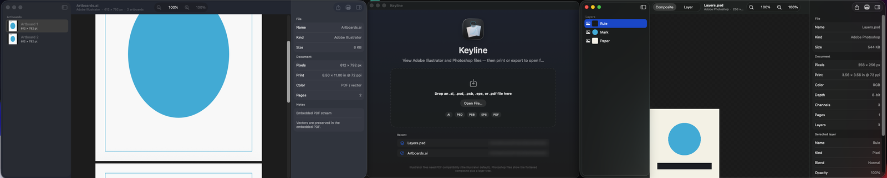

# Keyline

> View Illustrator and Photoshop files on a Mac without Adobe, and export to open formats.

<p align="center">
  
</p>

## What it does

A native macOS viewer for Adobe Illustrator and Adobe Photoshop files. It does not edit them. It shows them the way those apps would on screen, then lets you print or export to open formats.

## What it opens

| Extension | How Keyline reads it |
| --- | --- |
| `.ai`, `.ait` | PDF stream inside the file (Illustrator’s default “Create PDF Compatible File”) via PDFKit. Artboards become pages. |
| `.eps`, `.epsf` | Embedded PDF if present, otherwise the TIFF preview stored in a binary EPS header. |
| `.psd`, `.psb` | Flattened composite via Image I/O (color-managed, what Photoshop saved as the merged preview) plus a parsed layer tree and per-layer pixels when they are 8/16/32-bit RGB, gray, or CMYK. |
| `.pdf` | Opened as a document, useful for files already exported from Illustrator. |

Older Illustrator files saved **without** PDF compatibility are a private PostScript format. macOS no longer includes a PostScript interpreter, so Keyline cannot reconstruct those files. Re-save them from Illustrator with PDF compatibility on.

Photoshop adjustment layers, smart objects, and layer styles still appear in the layer list. Their *appearance* is in the composite; isolated pixels may be empty, which matches how the PSD format stores those layer types.

## Usage example

Drag `Samples/Layers.psd` onto Keyline to browse layers, then File > Export > OpenRaster to open the layers in Krita or GIMP.

## Export and print

- **PDF** — For Illustrator this is the embedded vector PDF, not a rasterization. For Photoshop it is a one-page PDF of the composite.
- **PNG / JPEG / TIFF** — Raster export at 1×–4×.
- **OpenRaster (`.ora`)** — Open layered raster (Krita, GIMP, MyPaint). Each decoded Photoshop layer becomes a PNG sheet inside a ZIP, with `stack.xml` preserving names, opacity, visibility, and groups.
- **Print…** — Standard macOS print panel, including **Save as PDF**.

PDF is the right open interchange format for Illustrator artwork. OpenRaster is the right open interchange format for layered Photoshop documents.

## Requirements

- macOS 14 or later
- Xcode 15 or later (Xcode 26 is fine)
- [XcodeGen](https://github.com/yonaskolb/XcodeGen)

## Quickstart

```bash
brew install xcodegen
git clone https://github.com/nightmoose/Keyline.git
cd Keyline
xcodegen generate
open Keyline.xcodeproj    # Run (Cmd-R), then open an .ai or .psd
```

## Build

```bash
xcodegen generate
open Keyline.xcodeproj
```

Signing: choose your own team in Xcode. The bundle id is `com.nightmoose.keyline`; change it in `project.yml` if you sign under a different team.

Or from the command line:

```bash
xcodegen generate
xcodebuild -scheme Keyline -configuration Debug -derivedDataPath build
```

The Debug app lands at `build/Build/Products/Debug/Keyline.app`.

## Tests

```bash
xcodebuild -scheme Keyline -configuration Debug -derivedDataPath build test
```

The suite writes a small layered PSD and a PDF-wrapped `.ai` in memory, then checks parsing, layer names, and OpenRaster export.

Demo files (a two-artboard `.ai` and a three-layer `.psd`) can be generated with:

```bash
swift scripts/generate-samples.swift .
open build/Build/Products/Debug/Keyline.app Samples/Layers.psd Samples/Artboards.ai
```

## Project layout

```
Sources/App          Document types and menus
Sources/Models       Artwork, PSD, and Illustrator models
Sources/Services     PDF extraction, PSD parser, export, ZIP
Sources/Views        Welcome, canvas, layers, inspector
Tests                PackBits, loaders, round-trip fixtures
```

## License

[MIT](./LICENSE) © 2026 NightMoose, Inc.

Keyline is an independent project and is not affiliated with or endorsed by Adobe. Adobe, Illustrator and Photoshop are trademarks of Adobe Inc.
